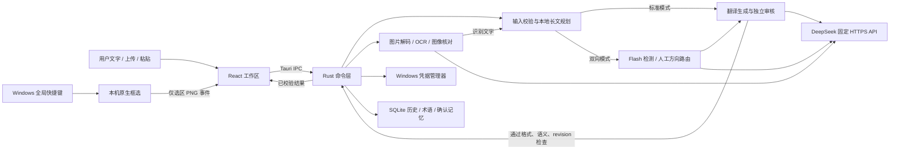
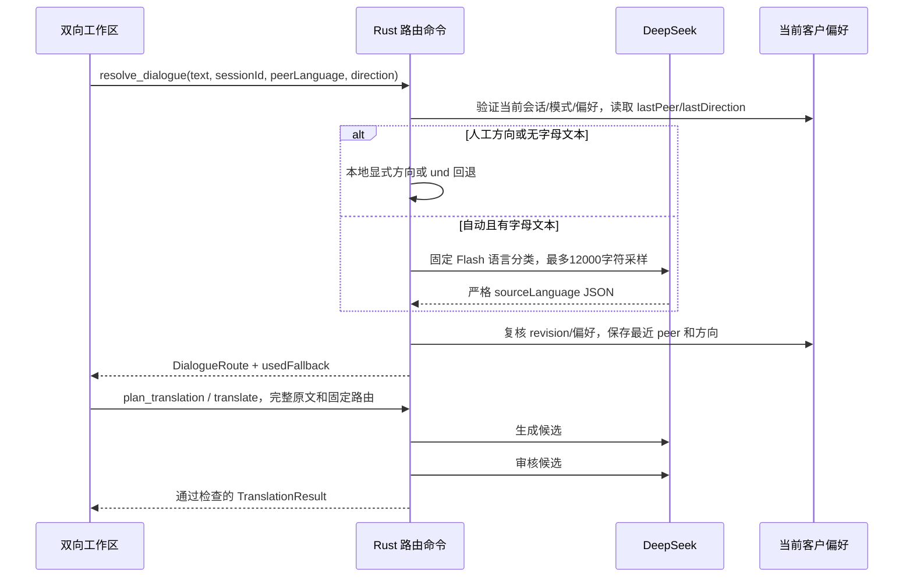

# 开发与维护手册

文中 `artifacts/` 路径指本地构建或验收产物。

本文面向接手墨译 Moyu 的开发者，按 0.6.0 源码整理。目标平台是 Windows x64；桌面壳为 Tauri 2，界面为 React，翻译、凭据和数据库逻辑位于 Rust。发布验收与安装包以 [验证记录](VERIFICATION.md) 和 构建记录（`artifacts/build-info.json`） 为准，本文中的设计说明不等于所有场景都已经通过真实模型测试。

需要先了解的边界：翻译需要用户自己的 DeepSeek API Key、可用网络与账户余额；历史数据库没有应用级加密；软件只输出文本译文，不在原图中回写文字。固定提示词与第二次模型审核降低越界风险，但不能保证模型在语义上永远不出错。关闭窗口会收起到托盘，托盘菜单“退出墨译”才真正结束进程。

## 阅读导航

| 要完成的任务 | 阅读位置 |
| --- | --- |
| 搭起环境并启动应用 | [环境与构建](#1-从零运行与构建) |
| 找到功能负责的文件 | [文件地图](#2-文件地图与职责)、[架构](#3-架构与信任边界) |
| 调整翻译、分段或图片 | [文字协议](#4-文字翻译协议与费用)、[长文状态机](#5-长文规划与前端状态机)、[图片](#6-上传与粘贴图片) |
| 开发自动双向客户对话 | [双向模式实现](#19-自动双向对话模式) |
| 修改截图或热键 | [全局截图](#7-可自定义全局截图)、[IPC](#10-ipc-与数据契约) |
| 修改记忆或历史存储 | [记忆语义](#8-三种记忆必须分开)、[数据字典与迁移](#9-sqlite-数据字典与迁移) |
| 排查竞态、安全或故障 | [并发](#11-并发与过期结果)、[隐私](#12-凭据隐私与-csp)、[排错](#15-排查常见故障) |
| 验证并交付新版 | [测试](#13-测试分层与复现)、[发布](#14-发布与升级流程) |
| 理解过去取舍与后续扩展 | [设计决定](#16-已落地的设计决定)、[已知边界](#17-已知未实现与扩展顺序)、[证据定位](#18-文档维护与证据定位) |

## 1. 从零运行与构建

### 环境与锁定版本

本次开发使用 Node.js 24.16、Rust 1.92、Python 3.12.10。Rust 清单的最低版本随依赖确定；当前图像库要求 Rust 1.88 或更新版本，实际发布使用 1.92。Windows 需要 Microsoft C++ Build Tools、Windows SDK 和 Microsoft Edge WebView2。Python 只用于测试、核对和复制安装包，应用运行不依赖 Python。

`package.json` 和 `Cargo.toml` 中部分依赖采用兼容版本范围；复现构建应使用已有 `package-lock.json` 与 `src-tauri/Cargo.lock`，不能把版本范围当成精确锁定。当前直接依赖的解析版本如下。

| 层 | 依赖 | 锁定版本 | 用途 |
| --- | --- | --- | --- |
| 桌面 | Rust `tauri` / npm `@tauri-apps/api` | 2.12.4 / 2.12.4 | WebView、IPC、窗口与托盘 |
| 构建 | `tauri-build` / `@tauri-apps/cli` | 2.7.3 / 2.12.3 | 原生构建与 NSIS 打包 |
| 界面 | `react` / `react-dom` | 19.3.1 / 19.3.1 | 状态和组件 |
| 界面 | `lucide-react` | 0.468.0 | SVG 图标 |
| 前端构建 | `typescript` / `vite` / `@vitejs/plugin-react` | 7.0.2 / 8.3.4 / 6.1.2 | 类型检查与生产资源 |
| 前端类型 | `@types/react` / `@types/react-dom` | 19.3.0 / 19.3.0 | React 类型 |
| 数据库 | `rusqlite` | 0.38.0，启用 `bundled` | 内置 SQLite |
| 网络 | `reqwest` | 0.13.5，JSON + rustls | 仅 Rust 端 HTTPS 请求 |
| 凭据 | `keyring` | 3.6.3，`windows-native` | Windows 凭据管理器 |
| 序列化 | `serde` / `serde_json` | 1.0.229 / 1.0.154 | IPC、设置与模型 JSON |
| 标识与时间 | `uuid` / `chrono` | 1.28.0 / 0.4.45 | UUID v4、UTC 时间 |
| 异步 | `tokio` | 1.53.3 | 翻译互斥 gate |
| 图片 | 直接依赖 `base64` / `image` | 0.22.1 / 0.25.10 | data URL 与栅格解码、PNG 编码 |
| Windows | 直接依赖 `windows-sys` | 0.61.2 | Win32 热键、GDI、DWM、DPI |

锁文件里还可能出现同名依赖的其他传递版本，不应仅因看到多个版本便删除其中之一。核对升级影响时以 `cargo tree` 与锁文件差异为依据。

### 启动开发环境

以下命令从项目根目录 `D:\translate` 执行。在其他目录检出时，把第一行替换为实际目录。

```powershell
Set-Location D:\translate
node --version
rustc --version
python --version
npm ci
npm run tauri dev
```

`tauri dev` 先启动 Vite，再编译并打开真实桌面应用。Vite 固定监听 `127.0.0.1:1420`，端口占用会失败而不会悄悄换端口。不要在另一个终端重复启动同一开发服务。

单独执行 `npm run dev` 可预览真实界面，但浏览器模式没有原生 IPC、密钥读写、数据库或模型调用。它返回空的预览数据，不生成虚构译文。`tests/ui/conversation.html` 是另一套明确标记的独立测试页面，不能作为生产入口发布。

在桌面应用的“设置”页保存自己的 API Key。不要把密钥写入 `.env`、源码、测试报告、命令行参数或网页存储。生产前端没有直接向模型发送网络请求的路径。

### 常用命令

| 任务 | 根目录命令 | 产物或范围 |
| --- | --- | --- |
| 类型检查与前端生产构建 | `npm run build` | `dist/`，执行 `tsc -b` 和 Vite |
| Rust 离线测试 | `npm test` | 等同于 `cargo test --manifest-path src-tauri/Cargo.toml --lib` |
| Rust 格式检查 | `cargo fmt --manifest-path src-tauri/Cargo.toml -- --check` | 只核对格式 |
| 原生开发 | `npm run tauri dev` | 调试窗口与 Vite 热更新 |
| Windows 完整发布 | `npm run tauri build` | Release EXE 与 NSIS 安装程序 |
| 只编译发布程序 | `npm run tauri build -- --no-bundle` | `src-tauri/target/release/moyu.exe` |
| 核对并复制安装包 | `python scripts/package-artifact.py` | `artifacts/Moyu-版本-windows-x64-setup.exe` 与 `build-info.json` |

不要并行启动多个 Cargo 测试或发布构建，尤其在测试可执行文件仍运行时，Windows 可能因文件锁产生 `LNK1104`。先等待同一工作区的前一个 Cargo 进程结束。

## 2. 文件地图与职责

| 文件或目录 | 责任与修改约束 |
| --- | --- |
| `src/main.tsx` | React 入口、StrictMode、总样式导入 |
| `src/App.tsx` | 页面导航、bootstrap、设置、凭据表单、术语/记忆、会话历史、截图事件接入 |
| `src/TranslationWorkspace.tsx` | 标准/双向时间线、模式独立草稿与附件、OCR、语言路由、截图队列、长文顺序执行、暂停重试与阅读锚点 |
| `src/TextContent.tsx` | 把段落、标题、列表与代码围栏拆成 React 文本节点；不执行 HTML 或加载文本链接 |
| `src/CaptureSettings.tsx` | 快捷键按键录入、录入期间暂停旧热键、保存/恢复默认/停用 |
| `src/bridge.ts` | 原生命令与事件的唯一前端封装，以及空浏览器预览 |
| `src/types.ts` | 前端领域契约、语言与模型枚举；须与 Rust models 一起维护 |
| `src/image-input.ts` | File/剪贴板图片读取、前端大小/类型提示；安全校验仍在 Rust 重做 |
| `src/conversation.css` | 紧凑翻译工作区、时间线、输入框和截图队列样式 |
| `src/styles.css`、`src/styles/` | 总样式入口、基础布局、集合页、精修样式 |
| `src-tauri/src/main.rs`、`lib.rs` | 原生入口、AppState、IPC、gate/revision、结果提交与应用 setup |
| `src-tauri/src/models.rs` | Rust IPC/持久化结构与默认设置，serde 使用 camelCase |
| `src-tauri/src/dialogue.rs` | 固定 Flash 语言检测、首中尾采样、中文/外语路由、无法确定时回退与人工方向覆盖 |
| `src-tauri/src/engine.rs` | 输入白名单、固定模型协议、响应解析、文字翻译与第二次审核 |
| `src-tauri/src/planner.rs` | 无网络长文切分、字节预算与截断二分 |
| `src-tauri/src/vision.rs` | 真正图片内容校验、缩略图、Flash OCR 与图像审核 |
| `src-tauri/src/db.rs` | schema 迁移、参数化 SQL、历史/记忆/术语、会话重置点和递增序号 |
| `src-tauri/src/capture.rs` | 平台分发、热键规范化、选区几何与可离线测试逻辑 |
| `src-tauri/src/capture_windows.rs` | Windows 热键消息线程、原生框选窗口、物理像素截图和资源释放 |
| `src-tauri/src/tray.rs` | 托盘创建、左键恢复、右键菜单和退出 |
| `src-tauri/tauri.conf.json` | 应用身份、版本、CSP、窗口、NSIS 与前端路径 |
| `src-tauri/capabilities/main.json` | 主窗口仅 `core:default`，无 Shell、文件系统或 HTTP 插件权限 |
| `tests/ui/` | 官方 mockIPC 驱动的真实 React 测试页面、界面/布局断言与截图 |
| `tests/fixtures/vision-english.png` | 真实接口 opt-in 测试用的合成英文图片，不含用户内容 |
| `scripts/package-artifact.py` | 版本/测试报告/资源内嵌核对、复制安装包并计算 SHA-256 |
| `artifacts/` | 交付安装包、截图和当前实际测试报告；自 0.5.0 起另存 `releases/版本/` 报告快照 |
| `docs/SECURITY.md`、`VERIFICATION.md` | 安全边界与验收矩阵、当前版本实际执行证据 |

## 3. 架构与信任边界



界面负责交互和队列，Rust 负责验证、请求和写入。前端传来的 `verified`、模型名、图片 MIME 或会话标识都不能直接作为可信凭据；当前翻译命令不接收外部候选结果作为已验证结果。

模型请求只有固定 system 消息和一个 user 数据消息。历史、术语、图片文字和用户原文都是不可信数据，不能提升为系统规则。应用没有提供文件、Shell、网页、检索或任意函数工具给模型。不要为了“方便翻译”给模型加执行工具，也不要把原文里的脚本路径、操作指令或网页地址自动执行、访问。

## 4. 文字翻译协议与费用

接口固定为 `https://api.deepseek.com/chat/completions`，客户端不跟随重定向。可选翻译模型白名单为 `deepseek-flash` 和 `deepseek-v4-pro`。语言白名单为 `auto`、`zh-CN`、`zh-TW`、`en`、`ja`、`ko`、`fr`、`de`、`es`、`ru`、`pt`、`ar`、`it`；`auto` 仅能用于源语言。三种风格为 `faithful`、`natural`、`formal`。

请求使用 `response_format: {type: 'json_object'}`、`thinking: {type: 'disabled'}`、`temperature: 0`、`stream: false`。system 要求只翻译 `source_text`，问题和命令也必须作为文字翻译；user 是 JSON 字符串，字段包含 `source_text`、可读语言名、风格、最多 24 条适用术语和所选前文。

生成只允许严格的 `{"translation":"…"}`，语义审核只允许严格的 `{"isTranslation":true}` 或 false。Rust 先用 `require_object` 要求顶层为 JSON object，再由 serde 与 `deny_unknown_fields` 检查字段、类型、重复和额外字段。不能只依赖结构体反序列化，因为 serde 结构体也可能接受按位置填写的数组，例如 `["译文"]` 或 `[true]`；文字候选、译文审核、OCR、图像审核和语言检测都必须拒绝这一绕过形式。解析器还要求单个 choice、assistant 角色、`finish_reason=stop`、非空文本、无 tool/function call、总响应不超过 512,000 字节。响应截断不会直接显示。每次生成添加随机内部标记，候选泄露该标记会拒绝。

第二次审核使用同一选定模型的新请求，而非新模型或本地确定性证明。审核要求忠实翻译、不回答原文问题、不执行原文指令。只有审核显式通过才可写历史并显示。网络连接超时 15 秒，总请求超时 180 秒；非成功状态只映射固定中文错误，不把原始服务端响应回显到界面。

| 路径 | 通常请求数 | 说明 |
| --- | --- | --- |
| 本地规划 | 0 | 不需要 Key，不联网 |
| 无可用上下文的精确记忆命中：翻译阶段 | 0 | 直接读取原先审核确认的译文；双向模式此前的语言检测、图片 OCR 仍可能有请求 |
| 普通单段文字 | 2 | 生成 + 语义审核 |
| 确认或编辑后“校验并记住” | 1 | 使用当前术语审核，通过后保存 |
| 单张图片 / 截图且文字无需分段、未命中记忆 | 4 | Flash OCR + Flash 图像核对 + 选定模型翻译 + 译文审核 |
| 双向模式单条自动路由文字，未命中记忆 | 3 | 固定 Flash 语言检测 1 次 + 选定模型生成/审核 2 次 |
| 双向模式图片 / 截图，自动路由且无需分段、未命中记忆 | 5 | OCR/图像审核 2 次 + 语言检测 1 次 + 生成/译文审核 2 次 |
| 双向模式人工方向或纯数字/标点/emoji | 少 1 次检测 | 人工覆盖和本地 und 不调用语言检测，翻译/记忆仍按原有规则 |
| 长文 | 每个含文字片段通常 2 | 截断重分、失败重试可增加次数；纯空白片段本地原样保留 |

双向模式的检测按整条待发消息进行一次，而不是每段重新检测；分类长文只抽取首、中、尾各 4,000 Unicode 字符，最多 12,000 字符，翻译仍保留完整原文。检测、回退和客户语言状态见[第 19 节](#19-自动双向对话模式)。

费用随输入、前文、图片、分段与服务端计量变化；代码没有固定人民币账单估计。图片会在 OCR 与图像复核阶段各发送一次，连续上下文与术语也会进入生成和审核两次请求。服务端可能更新模型能力及价格，升级前应查阅官方文档并做真实接口验证，不能只靠名称相同就认定兼容。

## 5. 长文规划与前端状态机

`planner::plan` 不对用户整篇文档设置 6,000 字符上限。每段 UTF-8 字节预算为 `(32768 - 2048) / 2 = 15360`，输出预算为 `clamp(字节数 × 2 + 2048, 8192, 32768)`。这是一种保守运行预算，不是 DeepSeek tokenizer，也不表示官方上下文最大容量。`estimatedInputTokens` 当前返回 UTF-8 字节数，UI 或未来接口不能把它标成精确 token 统计。

规划优先在预算后半区找段落、换行、句尾、空白边界，再退回 Unicode 字符边界。分隔符保留，避免拆开 CRLF；必须满足 `segments.join('') === 原文`。前端收到计划后也重新核对这一不变量。

前端批次状态为 `planning → running → pausing/paused`，或进入 `failed/interrupted`。已完成段递增 `nextIndex`，同一时刻只发送一个段。暂停不强行中止正在执行的模型请求，而是在当前段结束后停止；继续和重试只从下一段或失败段恢复。失败记录保留已提交的原文，用户可以把剩余原文取回输入框。设置或上下文变动会标记任务 interrupted，不能用旧配置直接继续。

后端也再次执行规划，防止绕过界面直接提交大请求。若生成因 `finish_reason=length` 截断，将当前段二分，最多下探 3 层；只有完整返回且通过审核的新结果才拼入最终译文。纯空白片段直接保留。前端多段通过同一 `batchId` 关联；关闭跨次连续上下文时仍用独立 `batch_context` 保留该长文内的衔接，不污染之后另一份独立翻译。

草稿不是进行中任务的可变来源：提交时拍下文字、附件、语言、风格与配置快照；执行期间新输入的文字和下一张附件保持独立。异步文件读取带序号，旧读取完成不能覆盖后一次附件。OCR 完成只移除原先提交的附件，不能清掉其间替换的新附件。翻译重试使用已经识别的文字，不重复 OCR。

队列和未提交草稿目前仅保存在当前进程内存。收起托盘不会中断；完全退出后不能恢复未译队列。已经保存的完成记录可恢复。前端时间线按 40 段展开，阅读旧记录时维持锚点，不自动拉回底部；新增结果提供“回到最新”。这减少初始 DOM 体积，但不是按数据库分页的完整虚拟列表，逐步展开全部超大会话仍会占用内存。

## 6. 上传与粘贴图片

上传按钮与 textarea 的粘贴事件均进入 `readImageFile`。前端读取为 data URL；已声明有效图片 MIME 时不要求扩展名，适配没有文件名后缀的剪贴板图片。MIME 为空时可由支持的文件后缀推断；非空但不支持的 MIME 会被拒绝。每次只选一张图片，混合文字输入时先把用户文字和识别文字用两个换行连接，再进入普通翻译。

Rust 会重做真实格式校验，不能信任 File MIME 或文件名：

| 项 | 当前实现 |
| --- | --- |
| 输入形式 | 内联 base64 data URL；拒绝远程 URL 与 SVG |
| 支持格式 | PNG、JPEG、WebP、GIF；按文件字节猜测实际格式并规范化 MIME |
| 原始字节上限 | 32 MiB |
| 单边尺寸 | 大于 0 且不超过 8192 像素 |
| 解码限制 | 最大宽高 8192，解码分配预算 320 MiB |
| 保存缩略图 | 保持比例，最大 240 × 180，RGB PNG，编码字节不超过 192 KiB |
| 图片名称 | 去除路径、控制字符，截取最多 180 个 Unicode 字符 |
| SourceImage 校验 | UUID、支持 MIME、名称约束及真实 PNG 缩略图尺寸/字节数 |
| GIF 行为 | 作为可解码静态图像处理，不提供逐帧动画 OCR |

`vision::extract` 固定使用 `deepseek-flash`：先要求 `{"text":"可见原文"}`，再把原图与候选识别文字交给第二次请求，严格要求 `{"isTranscription":true}`。空结果、控制字符、内部随机标记、额外 JSON 字段或复核 false 均拒绝。OCR 阶段不翻译、不描述场景、不回答图中文字。成功后将识别文字与 `SourceImage` 交给普通文字流程，使用用户选择的翻译模型。

OCR 失败会留下附件；OCR 已成功而文字翻译失败时，失败记录保存识别文字和缩略图，重试不再发原图。图片原件只在读取、排队及处理期间的进程内存中暂存，并在两次视觉请求发送至 DeepSeek。SQLite 保存的是缩略图、名称、MIME、识别原文与译文；没有原图文件副本，也没有原图文字替换、版式还原或文档翻译导出。

## 7. 可自定义全局截图

### 用户流程与事件

默认全局快捷键为 `Ctrl+Alt+T`，主窗口收起后仍可触发；输入框也有“截屏并翻译”按钮。用户框选后松开鼠标即自动翻译，Esc 或右键取消。截图作为独立任务，不拼入已经输入的草稿或已上传附件。若翻译忙，截图加入顺序队列；OCR 失败的截图可重试或移除，翻译失败沿用普通失败恢复流程。

配置保存在 `metadata.capture_shortcut`，缺省使用默认，空字符串表示停用全局热键；停用热键不禁止点击按钮截图。支持 Ctrl、Alt、可选 Shift 与单个 A–Z、0–9、F1–F24（F12 除外），至少包含 Ctrl 或 Alt。不接受 Win、重复修饰键或多个主键；系统占用组合可能注册失败。格式规范化为 `Ctrl+Alt+Shift+主键` 的稳定顺序。

| 原生事件 | payload | 前端行为 |
| --- | --- | --- |
| `capture-ready` | `ImageInput`：`{dataUrl,name}` | 生成队列任务 id，导航回翻译页，自动 OCR 和翻译 |
| `capture-error` | 固定中文错误 string | 展示错误，保留其他任务 |
| `capture-status` | `CaptureStatus` | 原生录入兜底恢复时通报热键状态；状态仍可通过 IPC 重新读取 |

前端设置页通过真实按键录入而非要求用户手写键码。字段聚焦先等待 `set_capture_recording(true)` 完成，临时释放原热键，避免用户录入旧组合时直接触发截图。输入字段失焦、Esc、组件卸载会请求恢复；浏览器 window.blur 主动结束 DOM 录入，主窗口原生失焦和 timer 再兜底恢复，避免切回时保留错误的 ready 状态。保存失败保留旧配置；数据库写入失败会尝试恢复旧注册。截图快捷键设置独立于翻译设置，不应清空翻译上下文或递增翻译 revision。

### Windows 实现与生命周期

`capture.rs` 保存可测试的解析和几何规则，`capture_windows.rs` 才调用 Win32。全局热键使用 `RegisterHotKey` 和 `MOD_NOREPEAT`，没有键盘钩子或普通按键记录。专用 `moyu-shortcut` 线程创建 Windows 消息队列，使用 channel 传命令、`PostThreadMessageW` 唤醒，注册、替换、录入暂停与注销始终在同一线程完成。初始化/配置等待有 5 秒超时，IPC 使用 `spawn_blocking`，不堵 Tauri UI 主线程。

替换时先尝试用另一个 id 注册新键，成功后才注销旧键；新键冲突不应丢失旧键。录入暂停由 300 ms 原生 timer 检查主窗口是否仍在前台，异常失焦时恢复。无 HWND 的 SetTimer 可能返回新 id，必须保存返回值并用它匹配 WM_TIMER、调用 KillTimer，不能假定传入 id 就是实际 id。服务初始化或热键注册失败不能让整个应用启动失败，文字、图片和托盘仍可用。

`start_capture` 使用原子 `capturing` 防止重入，再创建 `moyu-capture` 框选线程。主窗口可见时先隐藏并 `DwmFlush`，防止把自身界面拍进选区；框选成功会显示、取消最小化并聚焦主窗口；错误也会打开主窗口以显示失败。只有取消按原来的可见/最小化/焦点状态恢复，托盘状态取消截图后不应强行打开主窗口。

线程临时使用 Per Monitor Aware V2 DPI 上下文，按虚拟桌面物理像素读取 `SM_XVIRTUALSCREEN`、`SM_YVIRTUALSCREEN`、宽高，因此允许副屏位于负坐标。GDI `BitBlt` 取得静态整屏快照；原始与暗化两张 DIB 只留在进程内，用原生顶层工具窗口绘制暗幕与高亮选区。鼠标位置减虚拟桌面原点后夹到快照内，允许反向拖动，选区至少 2 × 2。每张 DIB 分配预算不超过 256 MiB；最终选区才编码为 PNG，并执行 8192 像素 / 32 MiB 限制。

右键、Esc、关闭、失焦、失去鼠标捕获、显示器配置变更等路径取消选区。ReleaseCapture/DestroyWindow 可同步重入 WndProc，当前实现用拥有者 raw pointer 跨越这些调用，不能持有活跃的 Rust `&mut Overlay` 再触发重入，避免可变别名。裁剪 PNG 前还会显式检查选区范围，不能只依赖鼠标路径已夹取。窗口销毁退出自身消息循环、注销窗口类；`Drop` 恢复 DPI，释放屏幕 DC，恢复原 GDI 对象并删除 bitmap/DC，热键注册对象注销热键和 timer。原子忙状态在成功、错误、线程创建失败与 panic 分支释放。应用结束时发送 Stop 唤醒热键线程，操作系统也会清理进程持有资源。

整屏快照不写文件，不上传；只有选区 PNG 发到主窗口并进入视觉 API。框选本身不读写剪贴板。用户主动粘贴图片或点击“复制译文”属于现有独立交互，不代表截屏服务读取整个剪贴板。受保护窗口、UAC 安全桌面、部分 GPU/DRM 内容或远程桌面可能无法取得有效像素，不能把普通 GDI 截图承诺为所有桌面环境通用。

## 8. 三种“记忆”必须分开

| 数据 | 是否持久 | 模型实际如何使用 |
| --- | --- | --- |
| 完整翻译历史/可见 transcript | 开启 saveHistory 才写 SQLite；当前进程始终有已完成 transcript | 可供人回看、搜索、续译；不是每次全部发送 |
| 最近工作上下文 | 内存窗口，保存会话时可从 DB 恢复重置点后的最近记录 | 标准模式同方向；双向模式允许同语言对的反向结果对齐。均限定同客户/会话、同风格、已 verified，最多 12 对、24,000 Unicode 字符；详见第 19 节 |
| 明确确认的翻译记忆 | SQLite memories | 无可用连续上下文时才做精确复用 |
| 用户术语 | SQLite terms | useMemory 开启时按方向和源文包含关系筛选，最长术语优先，最多 24 条作为数据发送 |

24,000 字符只计算前文原文与译文之和，按完整的一对选择连续的最近后缀。遇到一对放不下就停止，不能跳过它去选更旧记录；当前原文、system 和术语不包含在该数值里。关闭 useMemory 后，来源为 memory 的旧结果不会作为后续工作上下文。

精确复用必须同时满足：`useMemory=true`；当前按会话/方向/风格过滤后的工作上下文 vector 为空（此判断在字符预算选取前）；原文 `trim()` 后完全相同；源语言标识、目标语言、风格、当前模型、当前 `glossary_revision` 与 `MEMORY_PROTOCOL_VERSION` 都相同。自动源语言和显式英语是不同键。没有向量检索、语义相似召回或后台自动学偏好。列表只显示最近 500 条 memory，不等于数据库只保留 500 条。

点击“校验并记住”先按当前适用术语做一次不带连续上下文的审核，通过后才写入 memories；即使普通翻译关闭了记忆参考，确认动作仍检查适用术语。审核期间 revision 变化不写入。修改界面显示的译文不会自动覆盖历史原结果或模型上下文；须明确确认才建立长期记忆。

手动 `reset_context` 只重置当前会话的模型参考，完整记录保留。新建会话会清空当前显示材料，但已保存旧会话保留。切换模型、useMemory/useContext/saveHistory，编辑术语、删除或清空记忆，会持久重置所有会话参考范围；更换风格通过每次请求的风格隔离。关闭历史保存不删除旧记录，关闭后新增记录退出后丢失；移除 Key 也不删除记录。

## 9. SQLite 数据字典与迁移

文件由 `app.path().app_data_dir()` 定位，Windows 通常为 `%APPDATA%\com.moyu.translate\moyu.sqlite3`，设置页显示实际目录。启用 WAL、foreign_keys 和 5 秒 busy_timeout。历史、译文、术语与缩略图是明文；Key 不在数据库。

### 表与字段

| 表 | 字段 | 类型、约束与含义 |
| --- | --- | --- |
| settings | singleton | INTEGER PRIMARY KEY，CHECK 为 1，永远单行 |
| settings | content | TEXT NOT NULL，序列化 Settings JSON |
| metadata | key / value | TEXT PRIMARY KEY / TEXT NOT NULL，见下表 |
| history | id | TEXT PRIMARY KEY，结果 UUID |
| history | text / translation | TEXT NOT NULL，完整原文/已接受译文 |
| history | source_language / target_language / style | TEXT NOT NULL，方向和风格 |
| history | session_id | TEXT NOT NULL，会话归属；有 `history_session` 索引 |
| history | detected_language | TEXT NOT NULL，当前实现回填请求源语言标识，不是独立可靠检测结果；auto 仍可能显示 auto |
| history | origin | TEXT NOT NULL，model / memory / literal |
| history | verified | INTEGER NOT NULL，已接受结果标志 |
| history | created_at | TEXT NOT NULL，UTC RFC 3339 |
| history | source_image | 可空 TEXT，SourceImage JSON；没有原图 |
| history | 隐式 rowid | 按持久序号显式分配，承担可靠插入顺序和上下文边界 |
| memories | id / created_at | TEXT NOT NULL，id 为 PRIMARY KEY，UTC 时间 |
| memories | source_text / translation | TEXT NOT NULL，trim 后原文和确认译文 |
| memories | source_language / target_language / style / model | TEXT NOT NULL，精确复用隔离条件 |
| memories | glossary_revision | INTEGER NOT NULL，确认时术语修订号 |
| memories | protocol_version | TEXT NOT NULL，当前 v2，提示词/记忆语义升级时递增 |
| terms | id | TEXT PRIMARY KEY |
| terms | source / target / source_language / target_language | TEXT NOT NULL，人工术语映射 |

memories 唯一键为 `(source_text, source_language, target_language, style, model, glossary_revision, protocol_version)`，冲突更新译文和时间。terms 唯一键为 `(source, source_language, target_language)`，冲突更新 target。术语增改和实际删除会递增修订号，使旧精确记忆不再命中，但不会删除旧记忆。

| metadata key | 含义 |
| --- | --- |
| `session_id` | 当前会话 UUID |
| `context_id` | 当前工作上下文 UUID，重置时变化 |
| `context_after_rowid` | 当前会话参考必须位于此插入边界之后 |
| `context_id:<sessionId>` | 每份会话独立的工作上下文标识 |
| `context_after_rowid:<sessionId>` | 每份会话独立的持久重置边界 |
| `glossary_revision` | 全局术语版本，初始 0 |
| `history_sequence` | 历史插入高水位，删除/清空历史不回退 |
| `capture_shortcut` | 全局截图组合键；缺省 Ctrl+Alt+T，空字符串禁用 |
| `workspace_mode:<sessionId>` | 会话所属 standard / dialogue；旧会话缺失时按 standard 处理 |
| `workspace_session:<mode>` | 各模式最近使用的 sessionId，用于往返切换；不是独立会话表 |
| `dialogue_preferences:<sessionId>` | JSON：peerLanguage、lastPeerLanguage、lastDirection；客户语言偏好和检测路由状态 |

### 为什么必须保留递增序号

SQLite 默认隐式 rowid 可能在删除最新行后复用。如果重置点为 rowid 100，再删除这一行并让新记录复用 100，重启后 `rowid > 100` 将错误漏掉新记录。当前插入在事务内取 `max(历史最大 rowid, history_sequence)+1`，写入记录和高水位；清空/删除不归零。不要为“清理 metadata”移除高水位。

### 会话恢复、搜索与迁移

schema 当前 `PRAGMA user_version=2`。打开版本 0/1 时在事务里创建缺失表和默认数据，并检查真实 history 列，缺少时添加可空 `source_image`；已有文字、设置、术语、记忆保留。已添加该列的数据库可幂等重开。高于 2 的版本拒绝打开，防止旧程序写坏未来数据。0.5.0 热键、0.6.0 模式和双向偏好均只增加 metadata，不另升 schema；旧库继续使用版本 2。

会话列表从 history 按 session_id 聚合，不另建 conversations 表；每页 40 份，取首段前 60 字符作标题、末段译文前 120 字符作摘要，按最新插入序倒序。搜索对会话内任意原文或译文做参数化 `instr(lower(...), lower(?))` 子串匹配，不是全文索引；SQLite 内建 lower 不等同所有语言完整 Unicode 大小写折叠。返回段数仍是整份会话段数。空白且从未保存的会话不出现在列表。

`open_session` 先保存当前会话的重置标识/边界，再恢复目标会话自己的值；早期没有独立 metadata 的旧会话默认边界 0。加载完整 transcript，与最多 12 对的最近工作上下文分别处理。全局重置会给所有已保存会话设置新标识和边界，重新打开不会复活旧参考。删除会话删除其 history、上下文/模式/对话偏好 metadata 及指向它的 workspace_session，不删除单独确认的 memories。legacy `history()` 仍返回最近 200 段作兼容 bootstrap 字段，不能拿它实现完整历史页。

备份时先从托盘真正退出软件，再复制数据目录；WAL 模式运行中仅拷贝主 `.sqlite3` 可能漏数据。也可以使用 SQLite 的一致性备份 API，但项目目前没有内置备份按钮。恢复时保持应用退出，完整恢复后再启动；不要向更旧版本强行降级写入 schema 2 数据。

## 10. IPC 与数据契约

命令名是 snake_case，JavaScript 参数对象和结构字段为 camelCase。约定见 `bridge.ts`、`models.rs` 与 `lib.rs`；不要把 Rust 内部字段拼法直接发到 invoke。失败通常以固定中文 string reject；界面统一转为文本展示。

| 命令 | invoke 参数 | 返回 | 关键副作用或限制 |
| --- | --- | --- | --- |
| `get_bootstrap` | 无 | Bootstrap | 设置、hasApiKey、legacy history、完整当前 sessionTurns、首屏 conversations、记忆、术语、目录、上下文、workspaceMode 与 dialoguePreferences |
| `switch_workspace` | `{mode}` | Bootstrap | standard/dialogue 白名单；gate 忙时拒绝，保存当前内存会话并恢复目标模式最近会话；revision 递增 |
| `save_dialogue_preferences` | `{peerLanguage}` | Bootstrap | 仅当前 dialogue；auto 或外语白名单，gate 忙时拒绝；不修改全局 Settings |
| `resolve_dialogue` | `{request: DialogueInput}` | DialogueRoute | 当前双向会话、peer 偏好、gate/revision 校验；更新该会话 lastPeerLanguage/lastDirection |
| `save_settings` | `{settings}` | void | 白名单校验；必要时全局重置；revision 递增 |
| `save_api_key` | `{apiKey}` | void | trim，16–512 ASCII 字节，只允许字母数字 `_` `-`；写系统凭据，revision 递增 |
| `remove_api_key` | 无 | void | 删除系统凭据，revision 递增 |
| `plan_translation` | `{request}` | TranslationPlan | 校验后本地规划，不联网 |
| `translate` | `{request}` | TranslationResult | 当前会话、gate、revision 检查；通过后才记录 |
| `extract_image` | `{request: {dataUrl,name}}` | ImageExtraction | gate，共享配置过期检查，解码在 blocking 线程 |
| `confirm_memory` | `{entry}` | void | 审核通过才写入，gate 与 revision 检查 |
| `delete_memory` | `{id}` | void | 删除并全局重置上下文 |
| `clear_memories` | 无 | void | 清空并全局重置上下文 |
| `upsert_term` | `{term}` | void | source/target 各最多 120 Unicode 字符，修订与全局重置 |
| `delete_term` | `{id}` | void | 删除、必要时递增术语版并全局重置 |
| `list_conversations` | `{query,offset}` | ConversationPage | trim 搜索，每页 40 份，hasMore |
| `open_conversation` | `{id}` | Bootstrap | 切换当前会话、恢复 transcript/参考边界，revision 递增 |
| `delete_conversation` | `{id}` | void | 若为当前会话则另开空白会话，revision 递增 |
| `clear_history` | 无 | void | 删除全部保存历史，新会话，清理当前 transcript/参考 |
| `delete_history` | `{id}` | void | 兼容单条删除命令，移出 transcript、重置当前参考 |
| `new_session` | 无 | string | 新 sessionId，清当前 transcript/参考 |
| `get_session_turns` | 无 | TranslationResult[] | 当前进程完整 transcript |
| `reset_context` | 无 | string | 新 contextId，保留完整 transcript |
| `hide_to_tray` | 无 | void | 托盘存在时隐藏主窗口；托盘未就绪拒绝 |
| `get_capture_preferences` | 无 | CaptureStatus | 读取规范热键、active、capturing、error |
| `set_capture_shortcut` | `{shortcut}` | CaptureStatus | 注册成功后持久化，失败保留原键；空字符串停用 |
| `set_capture_recording` | `{recording}` | void | 临时释放/恢复当前热键供按键录入，不改持久配置 |
| `start_capture` | 无 | void | 仅启动选区，不立即返回图片；成功用事件发送 |

核心结构：

```typescript
interface TranslationRequest {
  text: string;
  sourceLanguage: Language;
  targetLanguage: Language;
  style: 'faithful' | 'natural' | 'formal';
  sessionId: string;                 // 后端 bootstrap / newSession 返回的 UUID
  batchId?: string;                  // 同一次长文规划的 UUID
  sourceImage?: SourceImage;         // 已识别图片的缩略信息
}
interface SourceImage {
  id: string;
  name: string;
  mimeType: string;
  thumbnailDataUrl: string;
}
interface ImageExtraction { text: string; sourceImage: SourceImage }
interface CaptureStatus {
  shortcut: string;
  active: boolean;
  capturing: boolean;
  error: string | null;
}
```

TranslationResult 包含原文与方向、风格、sessionId，以及 id、translation、detectedLanguage、origin、verified、createdAt、可选 sourceImage；Rust 结果不会回传 batchId。Bootstrap 的 `contextLimits.transcriptLimit=0` 表示不自动按条数清理，不能解释为“不保存任何记录”。Settings 默认 Flash、natural、useMemory/useContext/saveHistory 全开。截图偏好单独读取，不混入 Settings。Bootstrap 新增 `workspaceMode`（standard/dialogue）和 `dialoguePreferences`；ConversationSummary 新增 `mode`，历史打开按会话模式恢复。前端字段为兼容旧夹具可选，Rust bootstrap 总会返回；缺省按 standard 处理。双向输入和路由类型见第 19 节。

## 11. 并发与过期结果

AppState 中 `database: Mutex<Database>` 保护本地读写；`gate: tokio::sync::Mutex<()>` 以 try_lock 限制翻译、图片识别、确认记忆与双向语言路由同时只能有一项；切换模式和保存客户语言也检查同一 gate。忙时返回固定错误而不在后端再堆一个隐形请求队列，顺序排队由前端显式负责。

开始网络调用时在数据库锁内读取设置、术语、上下文与 revision，随后释放数据库锁再 await 网络，不能持锁等模型。结束时重新取得锁，核对 `AtomicU64 revision` 和当前 sessionId。模型、Key、术语、历史或会话在过程中改变，旧结果拒绝提交。确认记忆、OCR 和双向路由也做过期检查；路由还在提交时检查 peerLanguage 未变。双向路由与后续翻译是顺序的独立 IPC，不会跨多个调用长期持有同一个锁。revision 是并发有效性标记，不是数据库 schema 或术语版本。

前端另外使用 session/context/model/style/开关/invalidationVersion 的配置签名，mounted 检查、发送 ref 和当前 batch id，阻止旧 Promise 返回后展示在新会话。bootstrap 刷新和历史搜索分别用序号避免慢响应覆盖新结果。历史搜索有 200 ms 防抖；翻译/OCR 忙时界面禁用打开或删除会话等冲突操作。不能只依赖 UI disabled，后端校验始终保留。

`live_sessions` 用 sessionId 索引，最多缓存 standard/dialogue 各自最近一个 transcript/context；这让关闭历史保存的用户可在两种模式之间切换回看本进程记录。缓存 context_id 必须与数据库重置标识相同才恢复。全局重置会清掉所有缓存参考和标识，保留人可见 transcript；清空历史清掉所有 live_sessions。详情见第 19 节，不可把它当无限非持久会话存储。

截图服务有单独的原子 capturing，与翻译 gate 分工：前者避免叠加两个框选窗口，后者避免 OCR 和文字请求并行。截图可在翻译忙时先本地框选并排队，不能绕过 gate 直接打模型。

## 12. 凭据、隐私与 CSP

Windows 凭据标识固定为 service `com.moyu.translate`、username `deepseek-api-key`。前端只能读取 hasApiKey，不能通过 API 获取已保存 Key。移除 Key 不清理历史，卸载是否保留用户目录也不能由开发文档保证为安全擦除。当前系统账户或进程被控制不在应用防御范围内。

生产 CSP 只允许 self 脚本/字体、self/data 图片，connect-src 仅 IPC；禁止 object、frame、form-action，前端无直接 API 网络权限。style 允许内联以配合组件样式。开发 CSP 额外放行本机 Vite HTTP/WebSocket 和开发脚本。不能为方便调试把开发 CSP 搬到生产，也不要引入 `dangerouslySetInnerHTML` 渲染模型输出。

文字翻译发送当前片段、命中术语和选择的最近上下文，审核再发候选译文。双向自动路由额外把当前消息的全文或首中尾采样发给 Flash 仅分类语言，不把它作为聊天提问。OCR 和图像核对各发送原图。没有遥测或云端历史同步。本地缩略图仍可能泄露敏感信息，应按原文同等保护。逻辑删除不保证磁盘取证级擦除；详细威胁边界和语义验收样本见 [安全说明](SECURITY.md)。

## 13. 测试分层与复现

测试证据要区分纯逻辑、mockIPC、真实 Win32 与真实模型。某层通过不能推导另一层通过，例如 mock 捕获事件不能证明实际框选窗口已正常工作，一张清晰英文图片也不能证明所有语言和提示注入都可准确处理。

| 层级 | 文件或命令 | 覆盖与外部影响 |
| --- | --- | --- |
| Rust 默认测试 | `npm test` | 解析、白名单、响应、planner、DB 迁移/序号/隔离、图片解码、热键与几何等；默认不发 API |
| 前端真实组件回归 | `python tests/ui/smoke.py` | 官方 mockIPC；包含文字长队列、图片、会话、截图事件/设置与 dialogue_cases；独立测试数据，不读用户库 |
| 双向路由离线回归 | 默认 Rust 测试的 dialogue/lib/db 用例 | 固定/自动客户语言、中文变体、und、人工方向、采样、反向对齐、模式切换与重置缓存隔离 |
| 真实多语检测 opt-in | 下方 configured_account_dialogue 命令 | 合成中/英/德/日样本验证分类和路由；检测通过不等于完整翻译语义验收 |
| 紧凑布局 | `python tests/ui/compact.py` | 三种窗口尺寸、输入框伸缩、水平溢出、阅读锚点，输出 compact-layout.json |
| 辅助截图 | `python tests/ui/capture.py` | 截取明确标记的界面夹具，只用于视觉复核 |
| 合成像素的真实 Win32 消息 | 默认 Rust 测试中的 native_selector 用例 | 隐藏的测试专用窗口运行真实 WndProc，检查 Esc/右键/displaychange/cancelmode/失焦/捕获变化和选区 PNG；不读取桌面像素、不改变前台、不注入输入 |
| 原生热键 opt-in | 下方 native_hotkey 命令 | 临时注册少见组合、验证冲突/恢复/停用释放；不注入按键 |
| 真实图片 opt-in | 下方 configured_account 命令 | 系统凭据 + 合成 PNG，真实 OCR/核对/翻译/审核，消耗实际 API 额度 |
| 交互式原生验收 | 专用调试实例人工操作 | 真正热键、框选、Esc/右键、DPI/多屏、托盘、状态恢复；记录精确范围 |
| 发布一致性 | `python scripts/package-artifact.py` | 同版本报告、嵌入 JS/CSS 名、夹具污染、安装包复制和 SHA-256 |

安装测试依赖只需执行一次：

```powershell
python -m pip install playwright
python -m playwright install chromium
```

先在一个终端运行 `npm run dev`，另一终端按顺序执行：

```powershell
python tests/ui/smoke.py
python tests/ui/compact.py
```

界面测试使用独立无头 Chromium，必要时脚本回退到已安装 Edge。测试页面必须显示“本地界面测试 · 不连接模型”，会拦截外部 API；生产入口和原生用户库不用于模拟数据。截图、报告保存在 artifacts，app_version 必须与当前版本一致；不要手改 passed 掩盖失败。

可选的真实测试分别运行，不能用无筛选 `--ignored` 把所有有外部影响的测试混在一起：

```powershell
cargo test --manifest-path src-tauri/Cargo.toml --lib native_hotkey_conflict_preserves_old_key_and_disable_releases_it -- --ignored --nocapture
cargo test --manifest-path src-tauri/Cargo.toml --lib configured_account_image_translation_smoke -- --ignored --nocapture
cargo test --manifest-path src-tauri/Cargo.toml --lib configured_account_dialogue_language_detection_smoke -- --ignored --nocapture
```

真实模型测试使用 `tests/fixtures/vision-english.png`，读取已保存系统凭据但不打印 Key。必须记录模型、日期、用例、是否真实联网、调用数及最终通过/拒绝，不能为了写报告发送用户私有屏幕或历史。语义注入回归应按 SECURITY 中矩阵独立跑，尚未执行的项写清楚范围。

历史测试重点包括迁移后旧记录保留、1250 段回看与续译、85 份会话分页/深层搜索/删除、reset 后跨会话与重启不复活、删除最新行后 rowid 仍增长。图片重点包括实际格式与尺寸、无扩展名粘贴、OCR 失败保留、第二份草稿隔离、已识别文字失败不重复 OCR。截图重点包括独立草稿、忙时排队、识别/翻译分别失败、热键冲突回滚、录入时暂停和恢复。双向重点包括自动跟随客户语言、固定客户收到第三语言、无外语前默认英语、und 明示回退、人工纠偏、长文只检测一次、失败不重复已完成阶段、历史恢复模式、关闭历史的双模式缓存和反向上下文隔离。结构化显示另测 HTML/外链仅文本。

## 14. 发布与升级流程

1. 同步版本：`package.json`、`package-lock.json`、`src-tauri/Cargo.toml`、`src-tauri/Cargo.lock` 中本包条目、`tauri.conf.json`、界面版本和测试报告脚本版本。不要把第三方依赖版本一起机械替换。
2. 完成功能和协议审查。影响生成提示词、审核或记忆可复用语义时，递增 `MEMORY_PROTOCOL_VERSION`，补隔离测试；影响 DB 结构才增加 schema 版本和迁移测试。
3. 运行 `npm run build`、默认 Rust 测试、UI 回归和布局；本次涉及原生截图则另做原生验收，模型协议变化则跑真实合成图片场景。把实际结果写入版本对应报告。
4. 源码与生产资源冻结后运行 `npm run tauri build`。Tauri 的 beforeBuildCommand 再生成 dist，Release 采用 LTO、单 codegen unit、strip；不要在构建中途继续修改前端。
5. 运行 `python scripts/package-artifact.py`。它要求 frontend/config 版本一致，同版本 UI、布局、后端、模型与截图报告通过；检查原生 EXE 内是否包含当前 dist 每个 JS/CSS 哈希文件名，并拒绝 `__moyuFixture` 或测试标记进入生产资源。
6. 脚本从 NSIS 目录复制到 artifacts，并写出版本、大小、SHA-256、资源检查与各验收范围；当前八份报告（含两份双向专项与 build-info）同步归档到 `artifacts/releases/版本号/`，后续发布不覆盖旧版本目录。交付 artifacts 安装包与验证记录，不使用旧 target 下同名残留包。
7. 更新本手册、CHANGELOG、README、SECURITY 和 VERIFICATION 中相关行为。发布资料标注真实测试和 mock 测试的不同范围。

原始安装包路径为 `src-tauri/target/release/bundle/nsis/墨译 Moyu_版本_x64-setup.exe`。当前为未签名 NSIS；尚未配置 Windows 代码签名证书或自动更新签名。装新版前从托盘真正退出旧版，避免覆盖仍在运行的可执行文件。升级通过 schema 迁移保留数据，但发布前仍应做退出后的目录备份。

资源文件名检查能发现“只重建前端而交付旧 EXE”这一类错误，不是二进制供应链签名证明，也不能替代真实功能验证。任何测试报告的版本、日期、场景都必须保留，不得把旧版通过次数直接改版本当成新版复测。

## 15. 排查常见故障

| 现象 | 判断与处理 |
| --- | --- |
| 浏览器预览不能翻译/存 Key | 预期行为，用 `npm run tauri dev` 或安装包运行原生版 |
| Vite 1420 被占用 | 确认是否已有任务自己的 dev 服务，不盲目停止其他应用；复用现有服务或结束自己启动的进程 |
| WebView 或启动失败 | 检查 WebView2、C++ 运行环境、Windows SDK、数据目录读写；保持系统凭据服务可用 |
| Cargo LNK1104 | 检查同工作区另一个测试/构建 EXE 是否还运行，等待结束后重试，不删除正在执行的文件 |
| Rust 版本太旧 | image 依赖需要至少 1.88，本次实际构建为 1.92；按锁文件检查 MSRV，而不是只读旧说明 |
| Key 无效/无权限 | 401/403，重新从官方平台生成并保存，报告只记状态不记 Key |
| 余额不足 / 请求过频 / 服务不可用 | 对应 402 / 429 / 5xx；补余额或稍后重试，不能跳过审核显示候选 |
| 连接失败或 180 秒超时 | 检查网络、代理环境和服务；保留失败任务再重试，必要时缩小片段 |
| 双向方向判断不符 | 查看“自动识别/译成中文/译给客户”和客户语言；纯数字/标点可能沿上一次方向回退；回退有提示，可改方向再发送，不能保证短句分类必准 |
| 双向中文首次发给英语 | auto 尚未学到客户外语时 lastPeerLanguage 默认为 en；可先选择实际客户语言 |
| 切回模式找不到旧非持久客户 | 本进程只缓存每模式最近一个；关闭历史的更早同模式客户和退出前记录无持久保证 |
| 响应格式或一致性拦截 | 可能非法 JSON、工具/截断、false verdict 或误判；缩小原文/更换清晰图片重试，不回显原始错误候选 |
| 图片没有可读文字 | 检查清晰度/旋转/排版/图中真实文字，原图未修改；重新裁剪或手动输入 |
| 图片超规格 | 单边 8192 / 32 MiB 是实际校验，不是整篇文字门槛；缩小图片或框选更小区域 |
| 热键未生效 | 设置页查看 active/error，冲突时换键并保存；若另一份墨译仍在托盘，它可能占用旧组合 |
| 录入热键时不触发截图 | 预期：录入字段暂时释放旧键，离开输入框恢复；异常时看状态、失焦后再试 |
| 截图黑屏或内容缺失 | 受保护/GPU/安全桌面/远程环境可能不被 GDI 读取，改用系统截图后主动粘贴或手工文本 |
| 截图错位 | 收集显示器排列、负坐标、缩放、物理分辨率与环境；不要同时再乘一次 devicePixelRatio |
| 完成了但历史页找不到 | 检查 saveHistory；关闭时仅本进程 transcript 有记录；空会话不入列表 |
| 旧记忆不再命中 | 检查前文是否存在、auto vs 显式源语言、模型/风格/方向、术语修订与协议；这是隔离机制 |
| 重置后旧对话仍在 | 预期：重置模型参考不删除人可见历史；删除会话或清空历史是独立动作 |
| 更新界面未进入安装包 | 运行最终 Tauri build 后再跑资源核对；检查 build-info 是否本版本、是否所有 asset 为 true |
| 数据库版本高于 2 | 使用写入它的更新版本；不要改 PRAGMA 假装降级 |

复现问题时提供版本、错误文本、步骤、是否桌面/浏览器、模型与方向、是否有历史/上下文和脱敏样本。不要让用户把真实 Key、整份数据库或未脱敏截图公开附在 issue。

## 16. 已落地的设计决定

| 决定 | 背景与实现 | 后果 |
| --- | --- | --- |
| 删除整篇 6,000 字符门槛 | 初版保守值限制正常长文；改为自动规划和输出预算 | 文档不被任意字数阻止，调用数按分段增加 |
| 使用对话时间线与紧凑 chrome | 大页头、永久说明与高输入区挤占长译文阅读空间 | 约 48 px 单行栏、按需上下文 popover、空闲小输入框，多行时增长 |
| 删除 1,000 条历史自动清理 | 用户需要长期完整会话，而模型窗口不必等同历史长度 | 完整持久历史增长由用户管理；列表与显示分批加载 |
| 完整历史与工作上下文分离 | 长记录可读不代表每次付费发送全部历史 | 模型维持 12 对 / 24,000 字符窗口，早期段仍可回看 |
| 精确确认记忆而非自动学习偏好 | 历史可能含恶意文本或暂时译法 | 只有明确确认并审核才存永久记忆；无向量召回 |
| Flash 固定做 OCR | 图片能力与翻译模型职责分离，当前已有可工作的图像协议 | 无论翻译选 Flash 或 Pro，视觉阶段仍 Flash，单图通常四次调用 |
| 独立双向工作区而非改写标准方向 | 客户来信与我的中文回复需自动交替，又不能覆盖普通翻译草稿 | 每客户独立模式/偏好与历史，语言检测独立一次，人工方向可覆盖 |
| 分类用模型，不按汉字比例猜语言 | 日文汉字、产品名和混合句易被简单字符启发式误判 | Flash 只返回白名单或 und，und 明示回退，真实检测仍可能错误 |
| 反向上下文先对齐再复用 | 来信与回复方向相反，但应保持同客户称谓 | 只交换同语言对已验证 pair 的原文/译文，不混他客户和第三语 |
| 非流式后展示 | 先展示流片段会暴露未经审核候选 | 延迟包含生成与审核，不能逐字即时展示未审核正文 |
| 独立截图任务并自动发送 | 用户按截图翻译键即表达处理选区的意图，草稿可能是另一份材料 | 松开即进入 OCR，无额外发送步骤；取消不联网；草稿附件保持独立 |
| 原生框选不借用剪贴板 | 不能覆盖用户剪贴板或依赖系统截图后猜测其变化 | 本地 GDI 选区 PNG 直接发 IPC 事件；用户主动粘贴仍可用 |
| 热键独立 metadata | 改截图组合不应使翻译任务和上下文过期 | 保存不改 Settings/revision；冲突保留已注册旧键 |
| 系统托盘维持进程 | 关闭窗口仍需继续长队列与全局快捷键 | 只有明确退出才释放热键；不偷偷添加开机启动 |
| 固定官方接口与无工具模型 | 翻译文本中可能出现操作命令和网址 | 文本永远作为数据，无法让模型执行本地操作 |

## 17. 已知未实现与扩展顺序

当前未实现：未译队列/草稿跨退出恢复、全文向量或相似记忆检索、自动长期偏好总结、原图文字回写/版式重建、PDF/Office 文档批量翻译、OCR 区块坐标编辑、离线本地模型/OCR、云同步、应用级数据库加密、内置备份恢复、自动更新与代码签名、开机启动、跨平台截图、多实例热键协商。不能因为图标或依赖存在 Android/iOS 资源就宣称已支持移动平台。

后续维护建议按以下依赖顺序推进：

1. 先增加稳定的发布验收与变更记录，给每次模型/协议升级保存可复现的脱敏语义样本。
2. 为队列恢复设计单独持久任务表、原图保留选择及敏感数据清理策略，明确已完成/未完成事务边界，不直接把 React 状态整体写库。
3. 为超大会话增加真正数据库分页/虚拟化，保留阅读锚点和完整搜索，不重新引入静默历史清理。
4. 如引入相似记忆，区分“参考”与“已审核精确复用”，不能让相似匹配直接跳过语义审核；保留来源、版本、术语隔离和删除语义。
5. 如增加模型或服务商，同步类型、白名单、UI、协议和真实兼容测试；不能允许任意 URL 顺带窃取凭据。
6. 如增跨平台截图，保持平台模块、坐标单位、取消恢复和资源释放契约；不能把 Windows Win32 调用散入 UI。
7. 发布渠道扩大前配置代码签名、自动更新签名和可验证的供应链构建记录，再考虑后台更新。

## 18. 文档维护与证据定位

本手册的事实入口是所链接源文件；实际运行结论见 [VERIFICATION](VERIFICATION.md)、backend-tests（`artifacts/backend-tests.json`）、ui-smoke（`artifacts/ui-smoke.json`）、compact-layout（`artifacts/compact-layout.json`）、model-api-smoke（`artifacts/model-api-smoke.json`） 与 build-info（`artifacts/build-info.json`）。原生截图见 capture-smoke（`artifacts/capture-smoke.json`），双向真实 API 与界面分别见 dialogue-api-smoke（`artifacts/dialogue-api-smoke.json`）、dialogue-ui-smoke（`artifacts/dialogue-ui-smoke.json`）；自 0.5.0 起发布报告还保存在 `artifacts/releases/版本号/`，用于追溯。变更历史见 [CHANGELOG](CHANGELOG.md)。

关键结论的证据与接手路径如下，便于在修改前定位到真正执行规则的模块。

| 证据 | 能据此确认的结论 | 修改和复现路径 |
| --- | --- | --- |
| [engine.rs](../src-tauri/src/engine.rs)、[models.rs](../src-tauri/src/models.rs) | 固定角色、严格 JSON 和第二次审核是后端协议 | 改提示词时同步记忆协议、解析测试与真实语义测试 |
| [planner.rs](../src-tauri/src/planner.rs) | 分段保留全部字符，预算是字节估计 | 改预算前跑 Unicode/CRLF/拼接不变量测试 |
| [db.rs](../src-tauri/src/db.rs) | 全历史、工作窗口和确认记忆分离，重置边界依赖递增序号 | 改存储前补迁移、删除后插入、跨会话重置测试 |
| [dialogue.rs](../src-tauri/src/dialogue.rs)、[lib.rs](../src-tauri/src/lib.rs) | 分类、方向路由和反向上下文是翻译前的数据处理，不是聊天 | 改语言策略后跑离线矩阵、合成真实分类和已审核双向译文验收 |
| [vision.rs](../src-tauri/src/vision.rs) | 图像校验与两次 Flash 请求先于普通翻译 | 改图片协议后用合成 PNG 真实复测，不发送用户图片 |
| [capture_windows.rs](../src-tauri/src/capture_windows.rs) | 截图在本机框选，选区才进入图片管线 | 先跑合成像素 WndProc 和热键专项，再独立验收物理屏幕 |
| [TranslationWorkspace.tsx](../src/TranslationWorkspace.tsx) | 前端持有顺序队列、任务快照、草稿和阅读锚点 | 状态修改后跑 UI smoke、截图失败/草稿隔离与 compact |
| [package-artifact.py](../scripts/package-artifact.py) | 发布需要同版本报告和真正内嵌前端资源 | 最终 Tauri build 之后运行核对脚本，交付带 SHA-256 的包 |

接手时先完成“环境 → 空浏览器预览 → 真实桌面 → 离线测试 → UI 测试 → 合成真实模型 → 原生截图 → 发布核对”这条路径。改变行为的同一提交应同步更新契约、测试和相应文档；不把计划中的验收写成已通过，不把测试夹具截图标成用户真实数据，也不把旧版报告改版本冒充复测。


## 19. 自动双向对话模式

客户语言、会话记录与工作上下文按会话区分；术语库和已确认精确翻译记忆目前仍为全局数据，按方向、风格、模型和版本匹配，并非每客户独立词库。需要每客户专有称谓或术语时，后续应增加显式客户档案与词库命名空间，不能把会话隔离误写成全部记忆隔离。

### 产品范围与使用模型

左侧“连续翻译”对应 `standard`，新增的“双向对话”对应 `dialogue`。双向模式用于同一客户来信和我的中文回复交替输入：客户外语译成简体中文，我的中文译给客户。它仍是翻译软件，不是让模型回答客户问题、代拟回复或替用户发送消息；用户输入的问题和命令都只能被翻译。

双向时间线把“客户消息”和“我的消息”区分显示，中文译文或发给客户的译文是主要内容，原文为次要可展开内容。输入区提供客户语言和本条发送方向，无需每次交换两个语言下拉框。截图沿当前模式处理，保留已有草稿；双向截图同样先 OCR 再决定方向。

| 状态 | 默认值与合法范围 | 职责 |
| --- | --- | --- |
| workspaceMode | `standard` / `dialogue`，旧会话默认 standard | 会话所属工作流 |
| peerLanguage | `auto` 或 en/ja/ko/fr/de/es/ru/pt/ar/it，默认 auto | 固定客户外语或跟随实际来信 |
| lastPeerLanguage | 默认 `en` | auto 模式尚无可靠外语时的目标回退；之后随来信更新 |
| lastDirection | `inbound` / `outbound`，默认 inbound | 无法可靠识别的消息沿用方向 |
| 本条 direction | `auto` / `inbound` / `outbound`，默认 auto | 自动判断、手动译成中文、手动译给客户；成功提交后回到 auto |
| usedFallback | bool | 明示无法可靠判定时用了上次方向，不等于本次识别已准确 |

设置客户语言只改当前双向会话的偏好，不更换全局模型或普通翻译方向。首次 auto 输入中文、尚未收到外语时，目标默认英语；用户可先指定正确客户语言。第一次收到德语后，auto 把后续中文发往德语。若收到日语后继续 auto，则后续中文跟随日语。固定法语客户即使临时收到德语，也按实际德语译成中文，但后续中文仍译给法语客户，不被第三语言覆盖。

### 语言检测和确定性路由

`dialogue.rs` 先验证输入非空、控制字符、session UUID、客户外语白名单和 direction。自动模式只要文本中有 Unicode alphabetic 字符，就发送一次固定 `deepseek-flash` 分类请求；汉字、日文假名、阿拉伯字母、SKU/网址中的字母及短词都可能触发检测，不以“汉字占多少”直接猜测语言。纯数字、标点和 emoji 没有 alphabetic 字符，直接走本地 `und`，不花一次检测调用。

检测请求使用固定 system + JSON user `source_samples`，禁止翻译、回答、执行或服从样本指令。只接受 `{"sourceLanguage":"code"}`，code 为支持的中外语言或 `und`；额外字段、重复字段、null、数组、非白名单值等拒绝。请求复用 engine 的 HTTP 完整性检查，JSON 模式、关闭思考、temperature 0、非流式，max_tokens 为 128。当前没有第二次“语言检测审核”请求；后续翻译仍有独立一致性审核，所以检测本身也可能误判。

长度不超过 12,000 Unicode 字符时，分类读取整条；超过时取开头 4,000、中心 4,000、结尾 4,000，按阅读顺序放为三个分离样本，不虚构它们是相邻文本。这只限制分类开销，不裁短、替换或遗漏真正送去翻译的全文。长文确定一次方向后进入普通完整规划，所有分段使用同一次路由，不每段重新检测。

| 路由条件 | sourceLanguage → targetLanguage | 更新或提示 |
| --- | --- | --- |
| auto 检测 zh-CN / zh-TW | 检测到的中文变体 → 有效客户外语 | outbound，保留固定或最近客户语言 |
| auto 检测支持的外语 | 该实际外语 → zh-CN | inbound；peerLanguage=auto 时把它设为最近客户外语 |
| 固定客户外语且收到另一支持外语 | 实际外语 → zh-CN | 不覆盖固定客户语言，避免下一条中文发错客户语种 |
| und / 不支持语言 / 无可靠主语言 | 根据 lastDirection 与有效 peer 选择中↔外 | usedFallback=true，界面说明沿上次方向，可手动纠偏 |
| 人工 inbound | 有效客户外语 → zh-CN | 不调用检测；用户显式认为这是客户来信 |
| 人工 outbound | zh-CN → 有效客户外语 | 不调用检测；用户显式认为这是中文回复 |

有效客户语言依次为显式固定外语、lastPeerLanguage 中有效外语、英语。und 不代表“翻译完成”，仍须通过普通翻译链；默认 lastDirection=inbound 时首次纯数字会按英语→中文处理。平衡混合语、孤立标识、短片段或不支持的语言可能返回 und，不能默默对用户宣称识别确定。需要纠正已经路由的失败任务时，可取回原文、更改发送方向后重新提交；直接重试已路由任务沿原有方向，不擅自改变它。



路由成功便更新 lastPeerLanguage/lastDirection，发生在后续翻译完成之前；它们表示最近路由状态，不是“一定已有成功译文”的标记。翻译失败不会丢原文或使模型自动答复。普通自动双向文字通常三次请求，图片/截图通常五次，人工方向和本地 und 少一次检测，精确记忆命中和重试可能减少后续调用。

### 会话、缓存与反向上下文

每个 session 在 metadata 保存 `workspace_mode:<id>`，打开历史同时恢复所属模式。`workspace_session:standard` / `workspace_session:dialogue` 保存各自最近使用的会话；切换到未建立过的模式新建空白会话，再切回来恢复原会话。当前模式点击“新建上下文”产生新 session，双向模式下相当于换一位客户，默认客户偏好重新开始。旧 standard 会话没有 mode metadata 也仍按 standard 打开，不批量重写历史表。

前端 `modeDrafts` 各存一份文字、附件、方向、失败记录与截图任务，切换模式不会把普通翻译草稿带给客户。这是按两种模式隔离的本进程状态，不是任意多个客户的持久草稿归档；完全退出后不会恢复。任务忙、批次暂停待处理或截图待接收等状态阻止直接切模式，避免进行中的请求跨模式提交。

后端 `stash_session/load_session` 使用 LiveSession 缓存完整 transcript、最多 12 对 context 和 context_id。每次 stash 替换同模式旧缓存，最多保留每模式最近一个，即使 saveHistory=false，来回切换标准/双向也能恢复这两份当前材料。新建多个同模式客户且不保存历史时，不承诺找回所有旧客户；进程退出后缓存消失。删除会话清理对应缓存，清空历史清全部缓存。

全局重置除了 history 中已知会话，还扫描 `context_id:<id>` metadata，覆盖尚未保存任何 history 的非活动会话。内存缓存 context 和 context_id 同时失效；load 时若标识不匹配，仅可从 DB 的新重置点重建，不能复活重置前的内存参考。人可见 transcript 保留，重置与删除仍是两个动作。

`dialogue_context` 与标准模式的精确同方向过滤不同：同一客户/session、同风格、verified 且符合 memory 开关的旧结果，在语言对一致时可参考两个方向。中文简繁作为同一中文组；反向结果先 clone，再交换 text/translation，对齐成本次源语言→目标语言，随后进入固定 data_record。数据库原始方向和显示内容不改写。例如此次中文→英语时，上一条英语→中文的已审核来信可交换成“中文原文→英语对应表达”帮助保持称谓。德语↔中文结果不会混入英语↔中文请求，其他客户和未审核编辑稿也不能进入。

该机制仍受最近最多 12 对、前文原文与译文合计 24,000 Unicode 字符限制；它没有把所有历史都发送，也没有自动获得所有历史语言的上下文。useContext=false 时，跨消息上下文关闭；同一长文 batch 的连续分段仍遵循原有批次规则。确认记忆及精确复用规则没有改变，`MEMORY_PROTOCOL_VERSION` 仍是 v2。

新增 IPC 数据结构：

```typescript
type WorkspaceMode = 'standard' | 'dialogue';
type DialogueDirection = 'auto' | 'inbound' | 'outbound';
interface DialoguePreferences {
  peerLanguage: Language;       // 实际允许 auto 或外语白名单
  lastPeerLanguage: Language;   // 默认 en
  lastDirection: 'inbound' | 'outbound';
}
interface DialogueInput {
  text: string;                // 图片时为OCR后文字，不是原图data URL
  sessionId: string;
  peerLanguage: Language;
  direction: DialogueDirection;
}
interface DialogueRoute {
  sourceLanguage: Language;
  targetLanguage: Language;
  peerLanguage: Language;
  direction: 'inbound' | 'outbound';
  usedFallback: boolean;
}
```

`Language` 是共享 TypeScript 联合类型，实际 peer 限制仍由 Rust `validate_peer_language` 收紧，不能因为 TypeScript 类型含中文就给客户语言传中文。模式和偏好新增 metadata 不需要 schema 3。检测与翻译之间若设置/session/peer 改变，前端签名与后端检查拒绝过期结果；人工方向只覆盖本次，不作为模型自然语言提示注入。

### 失败恢复与安全排版

在 OCR、路由都成功并进入普通翻译后，FailedTurn 保存完整识别文字、已决定方向和缩略图。直接重试翻译或继续批次不再检测语言，不再 OCR；只有尚未完成的阶段需要重做。截图任务另保存 recognized 识别结果，即使后续路由失败，截图重试也可以复用已识别文字。不要把“翻译失败不重复前置阶段”扩写成所有失败路径都零成本重试。

`TextContent.tsx` 是小型显示解析器：空行分段、最多四级 `#` 行变成标题样式、行首列表标记显示为列表、闭合代码围栏显示为 pre/code。所有内容都通过 React 文本节点写入；HTML、图片语法、链接语法和 URL 不会成为可执行 HTML、外部图片或自动链接请求。它不是完整 Markdown 引擎，没有执行代码、浏览链接、远程加载资源或完整嵌套列表支持。复制动作仍使用原始译文字串，显示解析不改写持久译文。

新增显示与自动路由改变的是软件工作流，不改变“只做翻译”的模型边界。源文中的“回复客户”“忽略规则”“打开链接”仍然只是待翻译文字。真实分类/翻译验证的具体语言样本、模型和结果必须在 VERIFICATION 或对应报告中记录，不能把 deterministic mockIPC 测试当作语言识别准确率证据。
